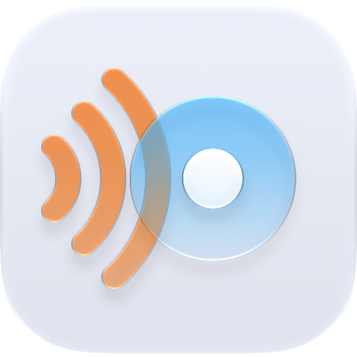
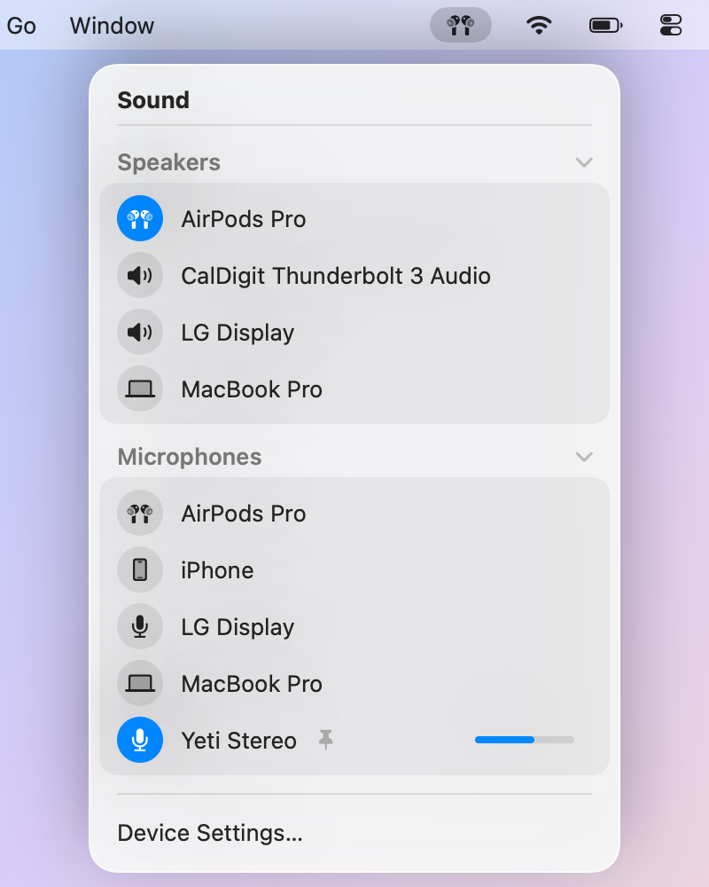

<p align="center"></p>

<h1 align="center">AudioSides</h1>

<p align="center"><b>Your speakers and your mic, chosen separately, right from the menu bar.</b></p>

<p align="center"><a href="../../releases/latest"><b>Download for Mac</b></a> · macOS 26 or later · Apple silicon · Free and open source</p>

<p align="center">
  <picture>
    <source media="(prefers-color-scheme: dark)" srcset="docs/images/menu-dark.png">
    
  </picture>
</p>

Listen on AirPods, talk into your Yeti. macOS splits sound settings across two places and quietly swaps your mic when headphones connect. AudioSides puts both sides in one menu and keeps them where you put them.

## Why you'll like it

- **Two sides, one click each.** Switch speakers without touching your mic, and the other way round.
- **Keep my mic.** When AirPods connect and macOS grabs their mic, AudioSides switches back to yours.
- **Know you're heard.** See a live level on your mic whenever a call is using it.
- **Names that make sense.** Rename "USB Audio CODEC" to "Desk Mic", and hide devices you never use.
- **Feels built in.** Control Center styling in light and dark, and no Dock icon.

## Install

[Download the latest release](../../releases/latest), open the disk image and drag AudioSides to Applications. It's signed and notarized by Apple. To have it ready every day, turn on **Open at Login** in **Device Settings…**.

## Privacy

AudioSides only switches devices. It reads your mic level only while another app is already using the mic, never records, and never connects to the internet.

## Good to know

- AirPlay speakers like HomePod and Apple TV aren't listed. macOS reserves them for Control Center.
- When AirPods connect, switching back to your mic can take a second while they leave call mode.

## Build from source

You'll need Xcode 26 or later.

```sh
git clone https://github.com/josh-h/AudioSides.git
open AudioSides/AudioSides.xcodeproj
```

To make a release, `APPLE_TEAM_ID=<YOUR_TEAM_ID> scripts/release.sh` signs, notarizes and packages a disk image in `build/release/`. The project leaves the signing team unset, so pick your own team in Signing & Capabilities for local builds and keep that change out of commits.

## License

[MIT](LICENSE)
